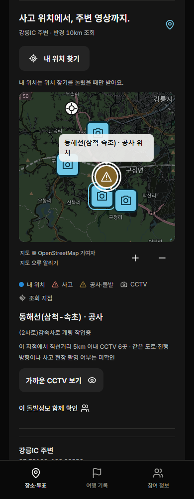
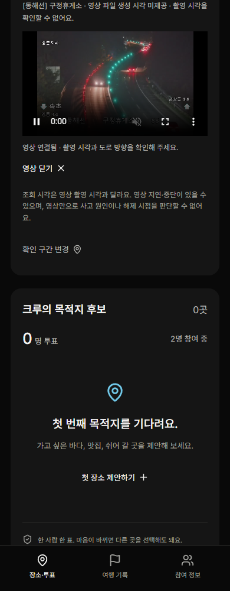

# CrewTrip

**운전자는 운전에 집중하고, 동승자는 함께 여행을 계획합니다.**

Pleos 차량 화면과 동승자 휴대폰을 여행방으로 연결하는 협업 여행 앱입니다. 동승자가 장소를 제안하고 투표하면 운전자가 정차 후 다음 경유지를 승인합니다. 이동 중 확인할 교통 상황도 동승자가 주변 CCTV와 함께 살펴보고 쉬어 갈 장소 제안으로 이어갈 수 있습니다.

2026 현대자동차그룹 차량용 앱 개발 공모전 개인 참가 프로젝트입니다.

## 제출 자료

| 자료 | 위치 |
|---|---|
| Android 서명 release APK | [`apk/hacho1_CrewTrip_release.apk`](apk/hacho1_CrewTrip_release.apk) |
| 소스 코드 | [`vehicle-app`](vehicle-app), [`passenger-web`](passenger-web), [`server`](server), [`shared`](shared) |
| 실행·설치 안내 | [심사용 실행 안내](docs/RUN.md) |
| 검증 결과와 지원 범위 | [검증 기록](docs/VALIDATION.md) |
| release 빌드·서명 | [빌드 안내](docs/BUILD.md) |

APK는 Pleos 에뮬레이터에서 같은 PC의 `http://10.0.2.2:4310` 서버를 사용하는 **에뮬레이터 시연용 release**입니다. 디버깅을 해제하고 전용 인증서로 서명했으며, 패키지는 `app.crewtrip.vehicle.demo`입니다. PC에서 아래 서버를 실행해야 화면과 여행방을 사용할 수 있습니다.

## 빠른 실행

Node.js 24와 Git이 설치된 Windows PowerShell에서 실행합니다.

```powershell
git clone https://github.com/hacho1/CrewTrip.git
Set-Location CrewTrip
npm ci
npm run build
Copy-Item .env.example .env
npm start
```

운전자 브라우저 시연은 <http://127.0.0.1:4310/vehicle>에서 시작합니다. 여행방을 만들고 초대 링크를 별도 브라우저나 같은 Wi-Fi의 동승자 휴대폰에서 열어 참여합니다. 실제 차량의 P/D 상태와 내비 연결은 Pleos 에뮬레이터에 APK를 설치해 확인합니다. [에뮬레이터 설치·기동 순서](docs/RUN.md)

실제 교통정보와 CCTV는 본인의 ITS 인증키를 로컬 `.env`의 `ITS_API_KEY`에 설정하고 서버를 다시 시작하면 사용할 수 있습니다. 키 없이도 화면의 **협업 흐름 시연**으로 장소 제안·의견·투표·확정 흐름을 확인할 수 있습니다. 이 시연의 돌발정보는 화면에 시연 자료로 표시됩니다.

## 사용자 흐름

1. 운전자가 정차한 상태에서 여행방을 만들고 초대 링크를 공유합니다.
2. 동승자가 각자 장소를 제안하고 투표합니다.
3. 동승자가 앞길 지도를 열어 사고·돌발 지점을 선택하고 주변 CCTV를 확인합니다.
4. 확인한 의견과 쉬어 갈 장소를 제안하고 함께 계획을 바꿉니다.
5. 운전자가 정차 후 경유지를 확정하고 차량 내비 연결을 요청합니다.
6. 여행 기록에서 함께 결정한 장소와 제안 당시 확인 구간을 확인합니다.

차량에서는 CCTV 영상을 재생하지 않습니다. P 기어와 AAOS 주행 제한 상태가 확인돼야 차량 화면에서 복잡한 조작을 할 수 있습니다. 동승자는 자신의 휴대폰으로 확인과 제안을 계속할 수 있습니다.

## 실제 지도·CCTV 연결 화면

2026-11-06 실제 OSM 지도와 ITS 데이터를 조회해 촬영한 동승자 브라우저 화면입니다. 해당 시점의 돌발정보는 동해선 공사였으며, 주변 구정휴게소 CCTV 재생을 확인했습니다.




교통정보·CCTV 출처는 [국가교통정보센터 ITS](https://www.its.go.kr/)이며, 지도 출처는 [OpenStreetMap 기여자](https://www.openstreetmap.org/copyright)입니다.

## 구현과 검증

- Android 호스트는 Kotlin과 Pleos Vehicle/NaviHelper SDK를 사용합니다. React UI를 WebView에 표시하고, 주행 제한과 SDK 접근은 네이티브에서 검사합니다.
- React·TypeScript·Leaflet으로 지도와 차량·모바일 UI를 만들고, Express·Socket.IO로 같은 여행방의 의견과 투표를 공유합니다.
- 서버 테스트 13건, 기존 브라우저 회귀 24건과 새 지도 회귀 1건을 확인했습니다. 실제 OSM·ITS·CCTV 연결 체크 7개를 통과했습니다. 시험별 모의·실제 범위는 [검증 기록](docs/VALIDATION.md)에 있습니다.

```powershell
npm test
npm run test:e2e
```

브라우저 테스트에는 Microsoft Edge가 필요합니다. 교통·위치·영상 장애와 D/P 상태를 모의 자료로 검사하는 테스트도 포함합니다.

## 현재 지원 범위

교통정보는 선택한 지점 반경 10km를 조회합니다. 사고·돌발을 선택하면 직선거리 5km 이내 CCTV를 가까운 순서로 제공합니다. 실제 내비 경로·진행 방향·사고 현장 촬영 여부는 매칭하지 않으며, 촬영 시각이 없는 경우 미확인으로 표시합니다.

휴대폰 위치는 버튼을 눌렀을 때 한 번 요청합니다. HTTPS와 위치 권한이 필요해 사설 IP의 HTTP 접속에서는 지도를 눌러 지점을 선택합니다. 새 사고 알림은 사용자가 켜고 화면을 보는 동안 1분마다 조회합니다.

여행방은 서버 메모리에 최대 12시간 보관하며 서버 재시작 시 사라집니다. 실제 휴대폰 2대의 전체 흐름, 실차 구동과 배포 서버 운영은 추가 검증 대상입니다. 현재 Pleos 에뮬레이터 조합에서는 일부 경유지 좌표와 TPMS 조회 권한에 제약이 있습니다. 내비 반영을 확인하지 못하면 UI에서도 미확인을 유지합니다.

[공모전 공식 제출 안내](https://appdevchallenge.auto-hmg.io/guide/submission) · [Pleos 개발 문서](https://document.pleos.ai/)
